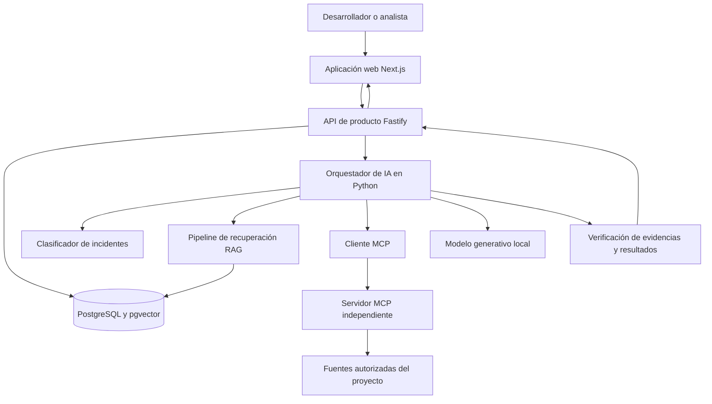
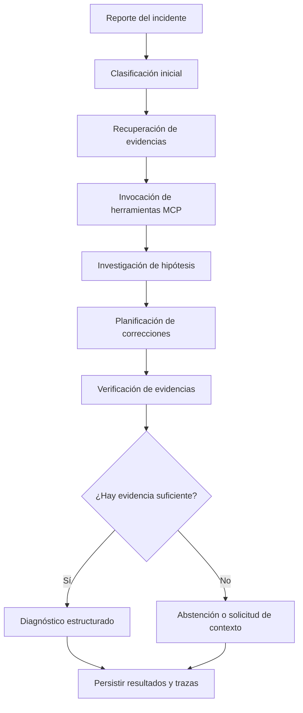

# SentinelOps AI

### Inteligencia artificial local para la investigación y el diagnóstico de incidentes de software

SentinelOps AI es un proyecto de ingeniería de inteligencia artificial enfocado en investigar y diagnosticar incidentes de software mediante análisis basado en evidencias, aprendizaje automático local, generación aumentada por recuperación (RAG), Model Context Protocol (MCP) y flujos de trabajo agénticos controlados.

El objetivo es construir un sistema especializado que ayude a los desarrolladores a comprender fallos de software conectando reportes de incidentes con documentación técnica, código fuente, contratos de API y registros de eventos.

En lugar de generar explicaciones aparentemente convincentes sin verificarlas, SentinelOps busca diferenciar los hechos observados de las hipótesis, identificar información faltante, validar referencias y recomendar pruebas que permitan confirmar o descartar posibles causas raíz.

**Estado del proyecto:** En desarrollo activo.

**Objetivo principal:** Construir y evaluar un sistema de inteligencia artificial especializado que pueda ejecutarse localmente sin requerir APIs de IA de pago para su funcionamiento principal.

**Repositorio:** [github.com/dantuki/SENTINELOPS-AI](https://github.com/dantuki/SENTINELOPS-AI)

---

## Tabla de contenido

- [El problema](#el-problema)
- [Visión del proyecto](#visión-del-proyecto)
- [Principios de ingeniería](#principios-de-ingeniería)
- [Arquitectura](#arquitectura)
- [Tecnologías](#tecnologías)
- [Implementación actual](#implementación-actual)
- [Estrategia de IA local](#estrategia-de-ia-local)
- [Flujo de investigación previsto](#flujo-de-investigación-previsto)
- [Seguridad y confiabilidad](#seguridad-y-confiabilidad)
- [Pruebas y evaluación](#pruebas-y-evaluación)
- [Configuración del entorno de desarrollo](#configuración-del-entorno-de-desarrollo)
- [Hoja de ruta](#hoja-de-ruta)
- [Limitaciones del proyecto](#limitaciones-del-proyecto)
- [Licencia](#licencia)

## El problema

La investigación de un incidente de software puede requerir que los desarrolladores examinen múltiples fuentes de información:

- Registros de aplicación y mensajes de error.
- Cambios recientes en el código.
- Especificaciones de API.
- Documentación técnica.
- Comportamiento de las bases de datos.
- Dependencias entre servicios.
- Incidentes anteriores y notas de diagnóstico.

Relacionar manualmente estas fuentes puede consumir tiempo, especialmente cuando la evidencia disponible es incompleta o contradictoria.

Un asistente convencional de inteligencia artificial puede generar una explicación convincente sin acceder al código relevante, sin verificar sus afirmaciones o sin diferenciar una hipótesis plausible de una causa raíz confirmada.

SentinelOps AI busca abordar este problema mediante investigaciones estructuradas, recuperación autorizada de evidencias, inteligencia local y verificación explícita.

## Visión del proyecto

El objetivo a largo plazo es construir una plataforma especializada de ingeniería de inteligencia artificial que permita:

1. Clasificar incidentes mediante un modelo de aprendizaje automático entrenado con un conjunto de datos específico del proyecto.
2. Ingerir e indexar documentación técnica, código fuente, contratos de API y registros.
3. Recuperar evidencias relevantes mediante búsqueda vectorial y léxica.
4. Invocar herramientas de investigación autorizadas a través de un servidor MCP real.
5. Analizar hipótesis alternativas sobre las causas raíz.
6. Identificar contradicciones y contexto faltante.
7. Generar planes estructurados de corrección y pruebas de regresión.
8. Verificar las referencias antes de presentar conclusiones.
9. Abstenerse cuando la evidencia disponible no sea suficiente.
10. Registrar las investigaciones y permitir evaluaciones reproducibles.

La plataforma está pensada para trabajar inicialmente con fuentes de proyectos autorizadas y datos sintéticos de demostración. El diseño inicial no permite realizar automáticamente cambios en sistemas de producción.

## Principios de ingeniería

### La evidencia antes que las suposiciones

Una hipótesis no debe presentarse como una causa raíz confirmada simplemente porque parezca plausible. Los hallazgos deben vincularse a fuentes verificables cuando corresponda.

### Inteligencia local como prioridad

El sistema está diseñado para utilizar modelos ejecutados localmente y embeddings generados localmente. Las APIs de inferencia de pago no deben ser un requisito para la demostración local prevista.

### Aprendizaje automático transparente

El proyecto distingue entre entrenar un modelo, adaptar un modelo existente, recuperar documentos mediante RAG y orquestar un flujo de trabajo. Son técnicas diferentes y deben documentarse como tales.

### Seguridad desde el diseño

El aislamiento entre proyectos, las herramientas restringidas, la validación estricta, la defensa frente a prompt injection y el tratamiento seguro de contenido no confiable son requisitos esenciales.

### Evaluación reproducible

Las afirmaciones sobre calidad y rendimiento deben apoyarse en pruebas ejecutadas y resultados medidos. Los tests con mocks, los datos sintéticos, las pruebas con modelos locales reales y las pruebas con proveedores externos deben identificarse por separado.

## Arquitectura

El repositorio utiliza un monorepo que separa la interfaz del producto, la API del backend, el orquestador de inteligencia artificial y la infraestructura.



**Importante:** este diagrama representa la arquitectura objetivo. No todos los componentes ni todas las conexiones que aparecen están implementados o verificados en el estado actual del repositorio.

### Responsabilidades de los componentes

| Componente | Responsabilidad |
|---|---|
| `apps/web` | Interfaz web construida con Next.js, React y TypeScript. |
| `apps/api` | API de producto desarrollada con Node.js, TypeScript y Fastify. |
| `services/ai-orchestrator` | Servicio Python para el procesamiento de IA y los futuros flujos de investigación. |
| `services/mcp-server` | Ubicación prevista para la implementación independiente del servidor MCP. |
| `packages/shared-contracts` | Contratos compartidos entre los componentes TypeScript. |
| `packages/config` | Configuración compartida del proyecto. |
| `infra/migrations` | Migraciones versionadas del esquema PostgreSQL. |
| `docs` | Documentación de arquitectura, seguridad, pruebas, implementación y decisiones técnicas. |

PostgreSQL proporciona persistencia relacional, mientras que pgvector permite realizar búsquedas vectoriales. La estrategia de recuperación definitiva busca combinar la búsqueda semántica y la léxica, en lugar de depender exclusivamente de la similitud vectorial.

## Tecnologías

| Área | Tecnología |
|---|---|
| Frontend | Next.js, React, TypeScript y Tailwind CSS |
| API de producto | Node.js, TypeScript y Fastify |
| Servicio de IA | Python, FastAPI y Pydantic |
| Orquestación de workflows | LangGraph, cuando aporte valor al flujo implementado |
| Base de datos | PostgreSQL |
| Recuperación vectorial | pgvector |
| Interoperabilidad con herramientas | Model Context Protocol (MCP) |
| Ejecución de modelos locales | Ollama u otro runtime local validado |
| Embeddings locales | Modelo de embeddings compatible ejecutado localmente |
| Infraestructura | Docker Compose |
| Pruebas | Herramientas de pruebas de Node.js, pytest y pruebas de integración |

Las tecnologías anteriores describen el stack existente y las decisiones previstas. Su inclusión no significa que todas las integraciones estén funcionando actualmente.

## Implementación actual

El repositorio ya cuenta con una base sobre la que continuar el desarrollo.

| Área | Estado actual |
|---|---|
| Estructura del monorepo | Presente |
| Interfaz Next.js | Existe una interfaz conceptual inicial |
| API Fastify | Implementada con rutas y comprobaciones de estado existentes |
| PostgreSQL | Configuración y migraciones presentes |
| pgvector | Extensión y migraciones de columnas vectoriales presentes |
| Fuentes y documentos de proyectos | Existen implementaciones de rutas y repositorios |
| Fragmentos documentales | Existen implementaciones de rutas y repositorios |
| Endpoint de embeddings | Implementado mediante un adaptador externo de OpenAI |
| Búsqueda semántica | Existen rutas de API y lógica de persistencia |
| Integración con un modelo generativo local | Pendiente de implementación y verificación |
| Embeddings locales | Pendientes de sustituir la integración externa actual |
| Clasificador de incidentes entrenado | Planeado |
| Servidor MCP independiente | Implementación y pruebas de protocolo pendientes de verificación |
| Investigación completa de incidentes de extremo a extremo | Todavía no verificada |
| Benchmark de evaluación | Planeado |
| Despliegue de producción | No implementado ni validado |

El endpoint actual de embeddings utiliza el modelo `text-embedding-3-small` de OpenAI y espera vectores de 1536 dimensiones. La transición a una arquitectura local debe tener en cuenta esta dependencia y gestionar de manera segura las migraciones y la compatibilidad de los embeddings.

Los resultados de pruebas reportados en sesiones anteriores no se presentan aquí como garantía de que el repositorio actual supere todas las comprobaciones. Las pruebas deben volver a ejecutarse sobre el estado real del código.

## Estrategia de IA local

El proyecto se desarrolla con una restricción clara: **el flujo principal de IA debe poder ejecutarse localmente sin necesitar APIs de inteligencia artificial de pago ni servicios externos de inferencia**.

La arquitectura de IA prevista cuenta con tres componentes complementarios.

### 1. Un modelo de aprendizaje automático especializado en incidentes

SentinelOps busca incorporar un clasificador entrenado con un conjunto de datos versionado de incidentes de software.

Entre las categorías posibles están los fallos de API, problemas de autenticación, errores de bases de datos, problemas de configuración, regresiones, degradaciones del rendimiento e incidentes con evidencia insuficiente.

Primero se evaluará una solución local sencilla, como TF-IDF con regresión logística u otro clasificador adecuado.

El proceso de entrenamiento debe ser reproducible e incluir datos de prueba independientes, métricas por categoría, una matriz de confusión y artefactos del modelo persistidos.

### 2. Un modelo generativo ejecutado localmente

Se seleccionará un modelo de pesos abiertos después de evaluar el hardware disponible, la memoria, el almacenamiento, el rendimiento de inferencia, el soporte de idiomas y la licencia.

El modelo deberá analizar evidencia técnica, comparar hipótesis, identificar información faltante y producir informes estructurados de investigación.

La inferencia se mantendrá local por defecto. Si el modelo local no está disponible, el sistema debe mostrar un error claro en lugar de cambiar automáticamente a un proveedor remoto de pago.

### 3. Embeddings locales y RAG

Los documentos técnicos, el código fuente, los contratos de API y los registros se procesarán e indexarán localmente.

La recuperación busca combinar:

- Similitud vectorial mediante pgvector.
- Búsqueda léxica o de texto completo.
- Combinación configurable y deduplicación de resultados.
- Filtrado por proyecto y permisos.
- Referencias verificables a las fuentes.
- Reordenamiento opcional cuando aporte una mejora medible.

La transición debe gestionar el esquema vectorial existente mediante migraciones controladas y no destructivas. Los embeddings de modelos incompatibles no deben mezclarse dentro del mismo espacio de recuperación.

### Evolución futura

Más adelante se podrá evaluar el ajuste fino mediante técnicas como LoRA o QLoRA, si el hardware, las licencias, los datos de entrenamiento y las mejoras medibles lo justifican.

SentinelOps no afirma entrenar un modelo fundacional de lenguaje desde pesos aleatorios. El objetivo es construir un sistema de IA especializado y propio mediante modelos locales, aprendizaje automático específico, recuperación documental, herramientas y evaluación rigurosa.

## Flujo de investigación previsto

El pipeline de investigación previsto es el siguiente:



Este flujo representa el diseño objetivo, no una afirmación de que todas las etapas estén funcionando actualmente.

El informe final de una investigación deberá incluir:

- Resumen y clasificación del incidente.
- Hechos observados.
- Referencias verificadas a las fuentes.
- Hipótesis alternativas.
- Evidencias que apoyan o contradicen cada hipótesis.
- Información faltante.
- Nivel de confianza y su justificación.
- Pruebas sugeridas para verificar las hipótesis.
- Plan de corrección recomendado.
- Pruebas de regresión.
- Resultados de verificación y limitaciones conocidas.

SentinelOps debe poder indicar: *«No hay evidencia suficiente para confirmar la causa raíz»*.

## Seguridad y confiabilidad

La seguridad es un requisito central porque el código, los documentos y los registros recuperados pueden contener instrucciones maliciosas o información engañosa.

Los controles previstos incluyen:

- Validación estricta de entradas y salidas.
- Acceso a documentos y herramientas limitado por proyecto.
- Protección contra accesos no autorizados entre proyectos.
- Herramientas de investigación restringidas y de solo lectura.
- Validación de rutas y protección frente a path traversal.
- Límites de tamaño, tiempos de espera y ejecución.
- Casos de prueba contra prompt injection.
- Validación de identificadores de fuentes y citas.
- Manejo seguro de errores y eliminación de secretos de los registros.
- Abstención explícita cuando la evidencia no sea suficiente.

La detección de prompt injection por sí sola no se considera una defensa suficiente. Los permisos, el aislamiento de datos, las restricciones de herramientas y la validación determinista deben imponerse desde la aplicación.

El sistema no se considerará seguro para producción únicamente por utilizar Docker, HTTPS o un modelo local. Los controles de seguridad deben verificarse mediante pruebas.

## Pruebas y evaluación

Las pruebas deben cubrir varios niveles:

- **Pruebas unitarias:** validación, reglas de negocio, lógica de clasificación, fragmentación y métricas.
- **Pruebas de integración:** PostgreSQL, embeddings locales, recuperación, MCP y componentes del workflow.
- **Pruebas de integración con modelos:** solicitudes reales de generación y embeddings a modelos locales instalados.
- **Pruebas de seguridad:** aislamiento de proyectos, documentos maliciosos, prompt injection y restricciones de herramientas.
- **Evaluación de IA:** métricas del clasificador, Recall@k, calidad del ranking, validez de las fuentes, calidad del diagnóstico, uso de herramientas y comportamiento de abstención.
- **Pruebas operativas:** latencia, errores, consumo de memoria e instalación reproducible.

Las pruebas de integración con modelos locales deben distinguirse de las pruebas con mocks. Que una prueba simulada termine correctamente no demuestra que un modelo real esté funcionando.

Los resultados de evaluación solo se publicarán después de ejecutar el benchmark correspondiente. Este README no afirma cifras de precisión ni de rendimiento.

## Configuración del entorno de desarrollo

### Requisitos previos

Antes de instalar dependencias, comprueba las versiones declaradas por el repositorio:

- Node.js y npm compatibles con el `package.json` de la raíz.
- Python compatible con `services/ai-orchestrator/pyproject.toml`.
- `uv` para gestionar el entorno y las dependencias de Python.
- Docker Desktop con Docker Compose.
- Espacio en disco y memoria suficientes para los modelos locales seleccionados.

Los requisitos declarados de Node.js y Python deben contrastarse con el entorno instalado antes de garantizar una instalación limpia.

### 1. Clonar el repositorio

```bash
git clone https://github.com/dantuki/SENTINELOPS-AI.git
cd SENTINELOPS-AI
```

### 2. Configurar el entorno local

En Windows CMD:

```cmd
copy .env.example .env
```

Edita `.env` localmente y configura los valores de PostgreSQL según las necesidades de tu entorno.

No subas `.env` al repositorio ni incluyas secretos en el código.

### 3. Instalar las dependencias de JavaScript

Después de comprobar que las versiones instaladas de Node.js y npm cumplen los requisitos del proyecto:

```bash
npm install
```

### 4. Iniciar PostgreSQL

Después de configurar `.env`:

```bash
docker compose up -d postgres
```

Comprueba el estado del contenedor:

```bash
docker compose ps
```

No utilices comandos que eliminen los volúmenes persistentes cuando necesites detener o reiniciar los servicios de desarrollo.

### 5. Ejecutar la API de producto

```bash
npm run dev --workspace=@sentinelops/api
```

La configuración de desarrollo actual utiliza el puerto `3001` por defecto.

### 6. Ejecutar la aplicación web

En otra terminal:

```bash
npm run dev --workspace=@sentinelops/web
```

La configuración actual de desarrollo utiliza el puerto `3000` por defecto.

### 7. Ejecutar el orquestador de IA

Utiliza versiones de Python y `uv` compatibles con la configuración del proyecto. Una vez implementada y verificada la configuración local, el comando previsto es:

```bash
uv run --project services/ai-orchestrator sentinelops-ai-orchestrator
```

La implementación actual de embeddings depende de una credencial de OpenAI. Por tanto, **el flujo completo de IA local todavía no está disponible simplemente iniciando el orquestador existente**. Sustituir esta dependencia y validar la generación y los embeddings locales son objetivos explícitos del desarrollo.

No añadas una clave de API de pago simplemente para seguir este README. La implementación local debe completarse y verificarse antes de afirmar que todo el flujo de IA funciona sin servicios externos.

### Ejecutar las pruebas

El repositorio incluye suites de pruebas para la API y el servicio Python. Ejecuta los comandos pertinentes después de comprobar la compatibilidad de las dependencias y el estado actual del proyecto.

Pruebas de la API:

```bash
npm test --workspace=@sentinelops/api
```

Comprobación de tipos de la API:

```bash
npm run typecheck --workspace=@sentinelops/api
```

Compilación de la API:

```bash
npm run build --workspace=@sentinelops/api
```

Pruebas del orquestador Python:

```bash
uv run --project services/ai-orchestrator pytest services/ai-orchestrator/tests/test_app.py
```

Una suite de pruebas solo debe declararse satisfactoria después de ejecutar el comando correspondiente y comprobar el resultado.

## Hoja de ruta

| Fase | Objetivo | Estado |
|---|---|---|
| 1 | Base de la aplicación y persistencia | Parcialmente implementada; verificar el estado actual |
| 2 | Generación y embeddings con modelos locales | Planeado |
| 3 | RAG local y recuperación híbrida | Pendiente de completar y verificar |
| 4 | Entrenamiento y evaluación de un clasificador propio | Planeado |
| 5 | Implementación y pruebas del servidor MCP independiente | Planeado |
| 6 | Construcción del workflow de investigación de incidentes | Planeado |
| 7 | Seguridad completa, trazas y benchmarks | Planeado |
| 8 | Integración del flujo de investigación con la interfaz web | Planeado |
| 9 | Entrega reproducible y preparación para despliegue futuro | Planeado |
| 10 | Evaluación opcional del ajuste fino local | Trabajo futuro opcional |

Las fases pueden ajustarse después de inspeccionar y probar el código. La implementación debe preservar el trabajo existente y no debe declarar una fase como terminada únicamente porque existan archivos o interfaces.

## Limitaciones del proyecto

SentinelOps AI es un proyecto experimental de ingeniería que todavía está en desarrollo.

En esta etapa:

- El flujo completo de investigación de extremo a extremo no se ha verificado.
- Las integraciones del modelo local y los embeddings locales requieren implementación y pruebas.
- El servidor MCP independiente debe verificarse mediante interacciones reales del protocolo.
- El clasificador específico del proyecto y el benchmark son componentes planificados.
- El rendimiento de los modelos locales depende del hardware disponible y del modelo seleccionado.
- Una futura publicación requerirá verificar controles adicionales de autenticación, autorización, aislamiento, infraestructura, copias de seguridad y seguridad.

El proyecto está pensado para fuentes autorizadas y demostraciones controladas. No debe utilizarse para efectuar cambios autónomos en sistemas de producción.

## Licencia

Este repositorio todavía no tiene una licencia especificada. Hasta que se incorpore una licencia, no debe asumirse que la disponibilidad pública del código autoriza su redistribución o reutilización.

---

**SentinelOps AI — Evidencia antes que suposiciones.**
