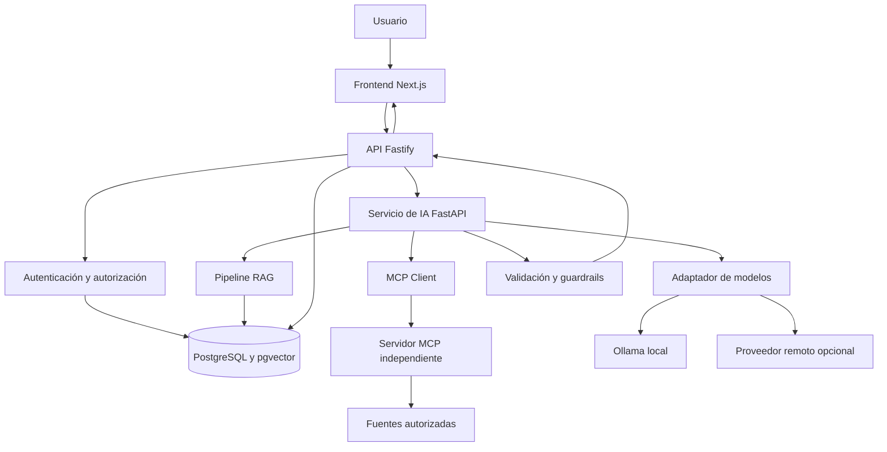
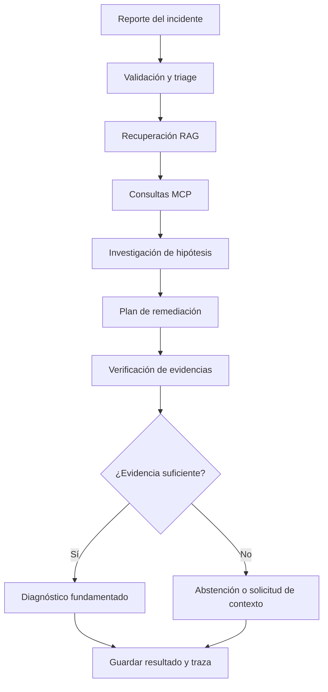
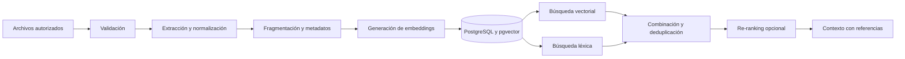
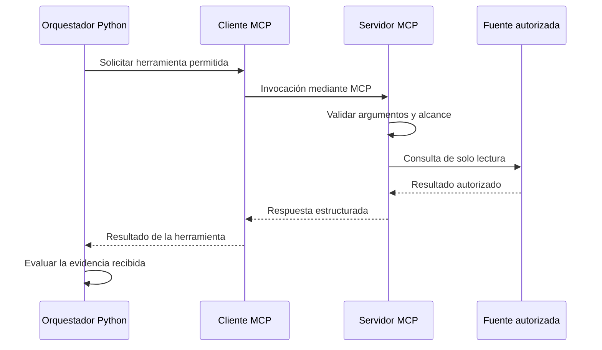

# SentinelOps AI — Arquitectura del sistema

## 1. Propósito

Este documento describe la arquitectura lógica inicial de SentinelOps AI, las responsabilidades de sus componentes y los límites de comunicación entre ellos.

El diseño está orientado a una plataforma de investigación de incidentes de software que utiliza recuperación documental, herramientas MCP, workflows de IA y validación de evidencias.

**Estado del documento:** propuesta arquitectónica inicial, pendiente de validación mediante ADR, revisión de dependencias y pruebas de integración.

## 2. Principios arquitectónicos

1. Separar la interfaz, la API de producto, la orquestación de IA y el servidor MCP.
2. Mantener contratos explícitos entre los servicios.
3. Aplicar autenticación y autorización en el servidor.
4. Aislar los datos por workspace y proyecto.
5. Tratar documentos, logs y código recuperados como contenido no confiable.
6. Utilizar herramientas de solo lectura durante la primera versión.
7. Conservar referencias verificables a las evidencias originales.
8. Permitir abstenciones cuando la evidencia sea insuficiente.
9. Evitar dependencias y servicios que no aporten un beneficio demostrado.
10. Mantener una ruta de despliegue reproducible en un VPS Linux con Docker Compose.

## 3. Vista general

La solución se dividirá inicialmente en los siguientes componentes:

| Componente | Tecnología prevista | Responsabilidad |
|---|---|---|
| Interfaz web | Next.js, React, TypeScript y Tailwind CSS | Experiencia de usuario y visualización de investigaciones |
| API de producto | Node.js, TypeScript y Fastify | Autenticación, autorización, proyectos, fuentes e incidentes |
| Motor de IA | Python, FastAPI, Pydantic y LangGraph cuando corresponda | RAG, workflows, análisis de hipótesis y verificación |
| Servidor MCP | TypeScript y SDK oficial de MCP | Exposición de herramientas autorizadas mediante el protocolo MCP |
| Persistencia | PostgreSQL | Datos relacionales y estado del producto |
| Recuperación vectorial | pgvector | Almacenamiento y búsqueda de embeddings |
| Procesamiento asíncrono | Pendiente de ADR | Ejecución controlada de ingestiones e investigaciones largas |
| Proveedor de modelos | Adaptador intercambiable | Acceso a modelos locales o remotos |
| Proxy inverso | Caddy, Nginx o Traefik | Entrada HTTPS y encaminamiento del tráfico en el VPS |

Esta tabla representa una propuesta, no una declaración de que los componentes ya estén implementados.

Las dependencias y versiones se validarán contra documentación oficial antes de generar los manifiestos definitivos.

## 4. Responsabilidades por componente

### 4.1. Frontend: apps/web

Responsabilidades:

- Mostrar el dashboard y las métricas verificadas.
- Administrar proyectos, fuentes e incidentes desde la interfaz.
- Mostrar el estado de las investigaciones.
- Presentar hechos, hipótesis, incertidumbres y recomendaciones por separado.
- Permitir navegar desde una afirmación hasta su evidencia.
- Mostrar trazas, errores y resultados de evaluación.
- Gestionar estados de carga, error, vacío y resultado parcial.

El frontend no será responsable de imponer permisos de seguridad.

No contendrá credenciales de proveedores ni conexiones directas con PostgreSQL, Redis u Ollama.

### 4.2. API de producto: apps/api

Responsabilidades:

- Autenticar a los usuarios.
- Validar las operaciones solicitadas.
- Aplicar autorización por workspace y proyecto.
- Gestionar proyectos, membresías, fuentes e incidentes.
- Crear investigaciones y exponer sus estados.
- Publicar los contratos HTTP mediante OpenAPI.
- Gestionar auditoría y errores de la API.
- Coordinar el acceso al motor de IA.

Toda solicitud sensible debe volver a comprobar la identidad y los permisos en el servidor. Conocer un identificador de proyecto o incidente no equivale a tener autorización para acceder a él.

### 4.3. Motor de IA: services/ai-orchestrator

Responsabilidades:

- Clasificar los incidentes.
- Administrar el estado de la investigación.
- Consultar la recuperación documental.
- Invocar herramientas mediante un cliente MCP.
- Formular y comparar hipótesis.
- Proponer planes de remediación.
- Verificar la estructura y el respaldo de las conclusiones.
- Gestionar límites de iteración y de recursos.
- Generar trazas de las etapas ejecutadas.

Las respuestas de los modelos no se considerarán confiables solo por tener un formato válido.

El motor deberá distinguir entre resultados observados, hipótesis, recomendaciones y acciones realmente ejecutadas.

### 4.4. Servidor MCP: services/mcp-server

Responsabilidades:

- Exponer herramientas mediante el protocolo MCP real.
- Validar parámetros y resultados.
- Consultar exclusivamente las fuentes autorizadas.
- Aplicar límites de longitud, cantidad de resultados y duración.
- Rechazar accesos fuera del proyecto autorizado.
- Registrar las invocaciones y sus resultados operativos.
- Producir errores útiles sin filtrar información sensible.

Las herramientas iniciales serán de solo lectura.

El transporte, la autenticación entre servicios y el uso concreto del SDK quedarán registrados en un ADR después de revisar la documentación oficial vigente.

### 4.5. PostgreSQL y pgvector

PostgreSQL almacenará la información relacional de la aplicación.

pgvector permitirá almacenar embeddings y ejecutar búsquedas vectoriales cuando el pipeline RAG esté implementado.

La búsqueda vectorial no será la única estrategia de recuperación. Se evaluará junto con la búsqueda léxica y una estrategia de combinación de resultados.

Los registros de negocio y los fragmentos documentales deberán conservar relaciones claras con sus proyectos y fuentes originales.

Se definirán índices, restricciones y políticas de acceso en el diseño del modelo de datos.

### 4.6. Proveedores de modelos

El motor de IA utilizará una interfaz de proveedor para facilitar el cambio de modelo.

Se contempla:

- Un proveedor local compatible con Ollama.
- Adaptadores para proveedores remotos que se seleccionen posteriormente.
- Validación de salidas estructuradas.
- Timeouts y límites de recursos.
- Tratamiento explícito de errores y cuotas.
- Registro de tokens, latencia y costos cuando los datos estén disponibles.

Las credenciales permanecerán en el backend.

El proveedor predeterminado se seleccionará después de comparar compatibilidad, privacidad, costo, latencia y recursos disponibles.

## 5. Arquitectura lógica

El diagrama representa los límites lógicos previstos. Las rutas concretas de lectura y escritura, la autenticación entre servicios y los permisos de base de datos deberán quedar definidos antes de implementar estas conexiones.

## 6. Flujo de investigación de incidentes

Una investigación seguirá conceptualmente este proceso:

1. El usuario registra un incidente.
2. La API valida la solicitud y los permisos.
3. Se crea el registro de la investigación.
4. Se clasifica el incidente mediante reglas y análisis de IA cuando corresponda.
5. Se recuperan fragmentos relevantes mediante RAG.
6. Se consultan herramientas MCP para obtener evidencia adicional.
7. Se generan hipótesis y se contrastan con las evidencias.
8. Se prepara un plan de remediación no ejecutable automáticamente.
9. Se verifican referencias, restricciones y estructura de salida.
10. Se guarda el resultado y la traza.
11. Se devuelve un diagnóstico o una abstención con los datos faltantes.

El workflow tendrá condiciones explícitas de parada, límites de iteración y tratamiento de errores.

No se realizarán llamadas a modelos innecesarias cuando una validación determinista sea suficiente.

### Diagrama del workflow

## 7. Pipeline RAG

El pipeline documental contemplará:

1. Validación de la fuente.
2. Extracción del texto.
3. Normalización y detección de contenido vacío.
4. Identificación y conservación de metadatos.
5. Fragmentación de documentos.
6. Generación de embeddings.
7. Persistencia e indexación.
8. Recuperación vectorial y léxica.
9. Combinación y deduplicación de resultados.
10. Re-ranking opcional.
11. Construcción del contexto con referencias verificables.

### Diagrama del pipeline

Los fragmentos incluirán, cuando estén disponibles, el proyecto, la fuente, la ruta del archivo, el tipo de contenido y su ubicación dentro del documento.

El sistema deberá poder comprobar que una referencia realmente existe y que corresponde a la fuente utilizada.

Un resultado de búsqueda no se considerará una prueba suficiente por sí solo.

## 8. Interacción MCP

La arquitectura separará el cliente MCP del servidor MCP.

El orquestador consumirá las herramientas mediante el protocolo implementado por el SDK oficial. No se reemplazará esta comunicación por simples funciones que solo aparenten ser herramientas MCP.

### Interacción prevista

Todas las herramientas deberán respetar el alcance de la investigación.

El modelo no podrá modificar los permisos, seleccionar herramientas fuera de la lista permitida ni solicitar acceso general al sistema de archivos.

## 9. Contratos y comunicación entre servicios

Cada interfaz deberá especificar:

- Esquemas de solicitud y respuesta.
- Identificadores de correlación.
- Autenticación entre servicios.
- Errores tipados y códigos apropiados.
- Timeouts y límites de ejecución.
- Reglas de compatibilidad y versionado.

La API de producto será la frontera pública de acceso a los datos del sistema.

El servicio de IA y el servidor MCP solo estarán disponibles mediante canales internos autorizados.

Los servicios no confiarán en un identificador de usuario o proyecto enviado libremente por el modelo. El alcance autorizado deberá proceder de un contexto validado por el backend.

Los contratos compartidos se mantendrán explícitos. Los tipos TypeScript y los modelos Pydantic deberán permanecer sincronizados mediante un mecanismo que se defina antes de implementarlos.

## 10. Persistencia y ejecución asíncrona

El modelo de datos se diseñará para conservar proyectos, fuentes, documentos, incidentes, investigaciones, etapas, evidencias, invocaciones de herramientas y evaluaciones.

Las investigaciones y las ingestiones largas podrán ejecutarse como trabajos asíncronos.

Antes de seleccionar el mecanismo de colas se compararán alternativas como:

- Ejecución mediante una cola dedicada.
- Procesamiento basado en trabajos persistidos en PostgreSQL.
- Redis con un trabajador compatible con el componente que procese los trabajos.

La decisión deberá considerar recuperación tras fallos, reintentos, idempotencia, estados duraderos y complejidad operativa.

No se incorporará Redis ni BullMQ sin un ADR que justifique su papel concreto.

## 11. Seguridad y límites de confianza

### Entrada

- Validar tamaños, tipos y formatos.
- Aplicar límites de frecuencia, duración y concurrencia.
- Controlar extensiones y contenidos de archivos.
- Rechazar o aislar documentos no válidos.

### Documentos y RAG

- Considerar no confiable todo contenido recuperado.
- Separar instrucciones del sistema y datos documentales.
- Evitar mezclar evidencias de proyectos distintos.
- Verificar los identificadores de referencias antes de producir la respuesta.

### Herramientas MCP

- Mantener una lista permitida de herramientas.
- Validar esquemas en el servidor.
- Aplicar permisos por proyecto.
- Impedir rutas no autorizadas y operaciones arbitrarias.
- Aplicar límites de resultados, timeouts y auditoría.

### Salida

- Validar estructuras.
- Comprobar referencias.
- Detectar información insuficiente.
- Redactar secretos cuando corresponda.
- Bloquear propuestas que excedan el alcance permitido.

La detección de prompt injection será una defensa complementaria. No sustituirá el aislamiento, la autorización, la validación ni las restricciones impuestas por código.

## 12. Entornos de ejecución

### Desarrollo local

- Aplicación ejecutada desde el entorno de desarrollo.
- Servicios de infraestructura mediante Docker Compose cuando corresponda.
- Datos sintéticos identificados como demostración.
- Variables de entorno locales excluidas del control de versiones.

### Pruebas

- Base de datos y credenciales separadas del entorno de desarrollo.
- Datos controlados y resultados reproducibles.
- Proveedores externos aislados mediante pruebas específicas.
- Sin conexión automática a sistemas de producción.

### VPS Linux

- Entrada pública mediante proxy inverso.
- HTTPS y redirección desde HTTP.
- Frontend y API expuestos únicamente a través de las rutas previstas.
- Motor de IA, servidor MCP y bases de datos en redes internas.
- Sin publicación pública de PostgreSQL, Redis u Ollama.
- Servicios con privilegios mínimos, límites de recursos y health checks.
- Backups, restauración, actualizaciones y rollback documentados.

La separación lógica de redes no se considerará suficiente por sí sola. La configuración y los puertos efectivos deberán comprobarse en el despliegue.

## 13. Observabilidad

Cada investigación tendrá un identificador de ejecución.

Se registrarán, según corresponda:

- Estado y duración de cada etapa.
- Herramientas MCP invocadas.
- Referencias recuperadas.
- Errores y reintentos.
- Iteraciones del workflow.
- Resultado de las validaciones.
- Estado final.
- Consumo y costo cuando existan datos reales disponibles.

Los logs no deberán almacenar secretos y evitarán conservar contenido sensible innecesario.

## 14. Decisiones pendientes de ADR

Antes de congelar la arquitectura técnica deben resolverse:

1. Versiones compatibles y estrategia de actualización de dependencias.
2. Transporte y autenticación MCP.
3. Contratos entre TypeScript y Python.
4. Persistencia de trabajos y estrategia de colas.
5. Proveedor de embeddings y estrategia híbrida de recuperación.
6. Proveedor de modelos y configuración de Ollama.
7. Autenticación, gestión de sesiones y modelo de autorización.
8. Proxy inverso del despliegue.
9. Límites de recursos y requisitos del VPS.
10. Estrategia de migraciones y backups.

Cada decisión importante tendrá un registro con contexto, alternativas, decisión, consecuencias y referencias técnicas.

## 15. Criterios para validar la arquitectura

La arquitectura no se considerará validada hasta que:

- Las responsabilidades y los contratos entre servicios estén definidos.
- Las dependencias seleccionadas tengan versiones compatibles verificadas.
- Se haya documentado el modelo de amenazas.
- Las pruebas definan cómo demostrar aislamiento entre proyectos.
- El protocolo MCP se ejercite mediante un cliente y un servidor reales.
- El pipeline RAG conserve referencias verificables.
- El workflow tenga límites y condiciones de parada.
- La topología de despliegue no exponga servicios internos innecesariamente.
- El diseño permita ejecutar pruebas reproducibles.
- Las decisiones pendientes estén resueltas o justificadamente aplazadas.
