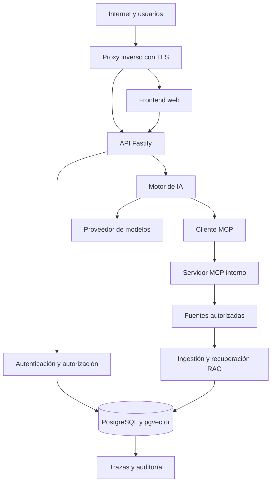

# SentinelOps AI — Modelo de amenazas y seguridad

## 1. Propósito

Este documento identifica las principales amenazas de seguridad de SentinelOps AI y establece controles para prevenirlas, detectarlas y comprobarlas.

El modelo contempla tanto la aplicación web expuesta a Internet como los componentes internos, las fuentes documentales, las herramientas MCP, los proveedores de modelos y el despliegue en un VPS Linux.

La seguridad se tratará como una propiedad que debe comprobarse mediante controles y pruebas concretas. Ningún mecanismo individual, incluidos HTTPS, Docker, autenticación o prompt engineering, garantiza por sí solo la seguridad del sistema.

**Estado:** modelo inicial de amenazas. Su aplicación y eficacia deberán verificarse durante la implementación.

## 2. Alcance

El modelo cubre:

- Aplicación web Next.js.
- API de producto Fastify.
- Motor de IA FastAPI y workflow de investigación.
- Servidor y cliente MCP.
- PostgreSQL y pgvector.
- Redis y trabajadores, si se incorporan.
- Ollama y proveedores remotos de modelos.
- Ingestión documental y recuperación RAG.
- Logs, trazas, evaluaciones y auditoría.
- Docker Compose y redes internas.
- Proxy inverso, TLS y firewall.
- CI/CD, dependencias y secretos.
- Copias de seguridad y recuperación.
- Operación de un VPS Linux.

La primera versión utilizará datos sintéticos y fuentes autorizadas. No deberá conectarse automáticamente a sistemas de producción de terceros ni ejecutar modificaciones destructivas.

## 3. Objetivos de seguridad

1. Proteger la confidencialidad de documentos, código, registros y credenciales.
2. Mantener la integridad de los datos y de los resultados de las investigaciones.
3. Garantizar que cada usuario solo pueda acceder a los recursos autorizados.
4. Mantener la disponibilidad frente a fallos y solicitudes abusivas.
5. Evitar que el contenido documental cambie las políticas de seguridad.
6. Limitar las capacidades del modelo a herramientas explícitamente permitidas.
7. Producir resultados trazables sin inventar evidencias ni acciones ejecutadas.
8. Facilitar la detección, investigación y recuperación ante incidentes de seguridad.
9. Mantener la instalación y el despliegue reproducibles.
10. Documentar los riesgos residuales y las limitaciones conocidas.

## 4. Activos que se deben proteger

| Activo | Riesgo principal |
|---|---|
| Credenciales de usuarios | Suplantación de identidad |
| Sesiones y tokens | Acceso no autorizado |
| Documentos y código fuente | Filtración de información |
| Logs de incidentes | Exposición de secretos y datos sensibles |
| Fuentes y fragmentos RAG | Acceso cruzado entre proyectos |
| Embeddings | Recuperación o inferencia no autorizada de información |
| Resultados e hipótesis | Diagnósticos incorrectos o manipulados |
| Herramientas MCP | Acciones o consultas fuera de permisos |
| Credenciales de proveedores | Uso fraudulento y consumo no autorizado |
| Base de datos | Robo, alteración o pérdida de información |
| Trazas y auditoría | Pérdida de trazabilidad o exposición innecesaria |
| Imágenes y dependencias | Ejecución de componentes vulnerables |
| Copias de seguridad | Filtración o imposibilidad de recuperación |
| Pipeline de CI/CD | Publicación de código o artefactos comprometidos |

## 5. Actores y límites de confianza

### 5.1. Actores

- Usuario autorizado que opera la plataforma.
- Usuario autenticado con permisos insuficientes.
- Atacante externo sin credenciales.
- Usuario malicioso con una cuenta válida.
- Documento que contiene instrucciones maliciosas o información manipulada.
- Proveedor de modelos externo.
- Servicio interno comprometido.
- Operador con acceso administrativo.
- Dependencia o imagen de contenedor comprometida.

Un usuario autenticado no debe considerarse automáticamente autorizado para todos los proyectos.

### 5.2. Límites de confianza

Se identifican los siguientes límites:

1. Navegador del usuario hacia el frontend.
2. Internet hacia el proxy inverso.
3. Proxy inverso hacia la aplicación web y la API.
4. API de producto hacia los servicios internos.
5. Motor de IA hacia el cliente y servidor MCP.
6. Servicios de aplicación hacia PostgreSQL y otros almacenes.
7. Aplicación hacia proveedores remotos de modelos.
8. CI/CD hacia el registro de imágenes y el VPS.
9. VPS hacia el sistema de backups.
10. Ingestión documental hacia el contenido no confiable.

Cada límite deberá definir autenticación, autorización, validación, exposición de red y gestión de errores según el flujo de datos.

## 6. Flujo de datos y límites de confianza

El diagrama es una representación lógica. No demuestra que los controles o las conexiones hayan sido implementados.

Los documentos, los logs, las respuestas de proveedores y cualquier otro contenido externo o recuperado se tratarán como datos potencialmente no confiables.

## 7. Catálogo inicial de amenazas

### T-01. Acceso cruzado entre proyectos

**Escenario:** un usuario cambia el identificador de una fuente, incidente o investigación para intentar acceder a los datos de otro proyecto.

**Impacto:** filtración, alteración o eliminación no autorizada de información.

**Controles previstos:**

- Comprobar autorización en el servidor para cada operación.
- Derivar el alcance de acceso de la identidad autenticada y de sus membresías verificadas.
- No confiar en identificadores proporcionados por el frontend o el modelo.
- Aplicar filtros de proyecto a consultas y herramientas.
- Evaluar políticas de aislamiento adicionales en la base de datos cuando resulten apropiadas.

**Verificación:**

- Crear dos usuarios o contextos de prueba con acceso a proyectos diferentes.
- Intentar leer recursos del proyecto ajeno.
- Repetir las pruebas sobre la API, las herramientas MCP, las referencias RAG y las trazas.
- Comprobar que el acceso se deniega sin revelar el contenido protegido.

### T-02. Robo de credenciales y secuestro de sesión

**Escenario:** un atacante obtiene una contraseña, token o sesión válida.

**Impacto:** acceso a información privada y ejecución de operaciones autorizadas para la cuenta comprometida.

**Controles previstos:**

- Hash de contraseñas con un algoritmo mantenido y parámetros apropiados.
- Sesiones seguras con expiración y revocación.
- Cookies `HttpOnly`, `Secure` y `SameSite` cuando se utilicen cookies.
- Protección CSRF cuando corresponda.
- Limitación de intentos y controles de abuso.
- Secretos fuera de los bundles del frontend.
- Política de rotación y revocación de credenciales.

**Verificación:**

- Solicitudes sin autenticación.
- Sesiones expiradas o revocadas.
- Roles insuficientes.
- Intentos repetidos de autenticación.
- Comprobación de que no se exponen credenciales en respuestas o logs.

### T-03. Prompt injection en documentos

**Escenario:** una fuente incluye instrucciones para ignorar políticas, revelar secretos o acceder a otros proyectos.

**Impacto:** filtración de datos, conclusiones manipuladas o solicitudes de herramientas no autorizadas.

**Controles previstos:**

- Tratar los documentos recuperados como contenido, no como autoridad de seguridad.
- Separar las instrucciones del sistema de los datos recuperados.
- Aplicar autorización y listas permitidas mediante código.
- Validar todos los argumentos de las herramientas.
- Restringir el contexto a los proyectos autorizados.
- Verificar el respaldo documental de las afirmaciones.
- Evaluar entradas adversariales con un dataset reproducible.

**Verificación:**

- Introducir documentos sintéticos con instrucciones maliciosas.
- Intentar que el contenido solicite herramientas fuera de alcance.
- Intentar obtener información de otros proyectos.
- Confirmar que los permisos no cambian y que el contenido no autorizado no se devuelve.

La detección de patrones sospechosos será una defensa complementaria, no la frontera principal de seguridad.

### T-04. Abuso de herramientas MCP

**Escenario:** el modelo o un cliente envía argumentos malformados, consulta rutas indebidas o intenta utilizar una herramienta no permitida.

**Impacto:** acceso no autorizado, consumo excesivo de recursos o fuga de información.

**Controles previstos:**

- SDK oficial y protocolo MCP real.
- Lista permitida de herramientas.
- Esquemas estrictos de parámetros.
- Autorización por proyecto.
- Consultas de solo lectura durante la primera versión.
- Límites de longitud, resultados y concurrencia.
- Timeouts.
- Registro de invocaciones sin almacenar secretos.
- Sin shell irrestricta ni acceso general al sistema de archivos.

**Verificación:**

- Argumentos inválidos.
- Herramientas inexistentes o no permitidas.
- Intentos de path traversal.
- Acceso a recursos ajenos.
- Timeouts y errores de las fuentes.
- Invocaciones concurrentes por encima del límite configurado.

### T-05. Inyección SQL y consultas inseguras

**Escenario:** una entrada intenta cambiar la estructura o el propósito de una consulta a la base de datos.

**Impacto:** acceso, modificación o eliminación no autorizada de información.

**Controles previstos:**

- Consultas parametrizadas.
- Validación de esquemas.
- Privilegios mínimos para cada usuario de base de datos.
- Ausencia de credenciales SQL generales en el contexto del modelo.
- No construir consultas concatenando entradas no confiables.
- Revisión de las operaciones sensibles.

**Verificación:**

- Pruebas con entradas maliciosas.
- Confirmación de que se preserva la estructura de las consultas.
- Comprobación de permisos efectivos de los usuarios de base de datos.
- Rechazo de operaciones no permitidas.

### T-06. Subida de archivos maliciosos

**Escenario:** el usuario carga archivos sobredimensionados, corruptos, con extensiones engañosas o diseñados para explotar una biblioteca de extracción.

**Impacto:** agotamiento de recursos, fallos de procesamiento o explotación de una dependencia vulnerable.

**Controles previstos:**

- Lista de tipos permitidos.
- Límites de tamaño y tiempo de procesamiento.
- Validación del contenido y no solo de la extensión.
- Manejo explícito de documentos vacíos o corruptos.
- Dependencias de extracción actualizadas.
- Procesamiento aislado cuando resulte necesario.
- Límites de CPU, memoria y concurrencia.

**Verificación:**

- Archivos corruptos y extensiones engañosas.
- Documentos vacíos.
- Archivos por encima del límite.
- PDFs con extracción fallida.
- Solicitudes repetidas de procesamiento costoso.

### T-07. SSRF y acceso a destinos no autorizados

**Escenario:** una entrada intenta inducir al sistema a solicitar direcciones internas o servicios no autorizados.

**Impacto:** acceso indirecto a servicios privados, metadatos del proveedor cloud o recursos internos.

**Controles previstos:**

- No descargar URLs arbitrarias en la primera versión sin un caso de uso documentado.
- Utilizar listas de destinos permitidos cuando se incorporen integraciones URL.
- Bloquear destinos internos no autorizados.
- Restringir las conexiones de red de los contenedores.
- Evitar que el modelo decida libremente a qué destinos conectarse.

**Verificación:**

- Entradas que apunten a destinos internos no permitidos.
- Redirecciones hacia destinos no autorizados.
- Intentos de usar herramientas documentales para acceder a servicios internos.

### T-08. Secretos en código, trazas o logs

**Escenario:** una clave API, token, contraseña o dato sensible aparece en el repositorio, la salida de una herramienta o un log.

**Impacto:** acceso fraudulento, fuga de datos o consumo no autorizado de servicios.

**Controles previstos:**

- Variables de entorno y gestión de secretos.
- `.env.example` sin secretos reales.
- Redacción de información sensible.
- Logs estructurados con contenido mínimo.
- Revisión de diffs antes de compartirlos.
- Detección automatizada de secretos en CI.
- Revocación y rotación tras una exposición.

**Verificación:**

- Usar valores ficticios marcados como secretos en pruebas.
- Confirmar que los mecanismos de redacción funcionan.
- Comprobar que los archivos de entorno reales no se versionan.
- Revisar los artefactos del frontend y las imágenes cuando corresponda.

### T-09. Agotamiento de recursos y denegación de servicio

**Escenario:** solicitudes excesivas, archivos grandes, consultas costosas o investigaciones que consumen recursos sin límite.

**Impacto:** interrupción del servicio y aumento de costos.

**Controles previstos:**

- Límites de frecuencia.
- Límites de tamaño y concurrencia.
- Timeouts por etapa.
- Máximo de iteraciones.
- Presupuesto de recursos por investigación.
- Límite de contexto y cantidad de documentos.
- Control de reintentos.
- Límites de CPU, memoria y almacenamiento cuando estén disponibles.

**Verificación:**

- Superación de los límites.
- Investigaciones que agotan sus iteraciones.
- Proveedores lentos o no disponibles.
- Solicitudes repetidas.
- Confirmación de que las operaciones terminan en un estado visible.

### T-10. Dependencias o imágenes comprometidas

**Escenario:** una dependencia, imagen base o paquete incluye una vulnerabilidad o código malicioso.

**Impacto:** compromiso de servicios, robo de secretos o interrupción de la aplicación.

**Controles previstos:**

- Lockfiles versionados.
- Versiones fijadas de dependencias e imágenes.
- Procedencia evaluada.
- Auditorías automatizadas de dependencias.
- Escaneo de imágenes cuando resulte viable.
- Actualizaciones controladas.
- Revisión de cambios de dependencias importantes.

**Verificación:**

- Ejecución de comprobaciones de dependencias.
- Registro de vulnerabilidades encontradas.
- Revisión de alertas y decisiones sobre riesgos.
- Confirmación de que las imágenes usadas corresponden a las versiones documentadas.

### T-11. Exposición de servicios internos

**Escenario:** PostgreSQL, Redis, Ollama, MCP o el motor de IA quedan accesibles directamente desde Internet.

**Impacto:** acceso no autorizado, manipulación o explotación de servicios internos.

**Controles previstos:**

- Publicar únicamente los puertos requeridos por el proxy inverso.
- Definir redes Docker explícitas.
- Evitar `ports` públicos para bases de datos y servicios internos.
- Aplicar firewall en el proveedor y en Linux.
- No exponer el socket Docker a contenedores de aplicación.
- Revisar las interfaces de escucha de los servicios.
- Mantener el acceso administrativo restringido.

**Verificación:**

- Inspeccionar puertos y publicación de contenedores.
- Revisar reglas de firewall.
- Comprobar desde un origen externo los puertos accesibles.
- Verificar que los servicios internos solo acepten conexiones desde los componentes autorizados.

### T-12. Pérdida, alteración o indisponibilidad de datos

**Escenario:** error de operación, corrupción, compromiso del host o fallo de almacenamiento.

**Impacto:** pérdida de fuentes, investigaciones, configuración o auditoría.

**Controles previstos:**

- Backups periódicos.
- Al menos una copia fuera del VPS.
- Cifrado y permisos restrictivos.
- Procedimiento de restauración.
- Política de retención.
- Copias antes de migraciones de riesgo.
- Procedimientos documentados de rollback.

**Verificación:**

- Restauración real en un entorno separado.
- Comprobación de la integridad de los datos restaurados.
- Registro de fecha, método y resultado.
- Corrección de fallos detectados durante la restauración.

No se afirmará que los backups funcionan hasta completar una restauración de prueba.

### T-13. Manipulación o fuga en la cadena de CI/CD

**Escenario:** una credencial de CI es comprometida o una modificación no revisada llega a producción.

**Impacto:** publicación de artefactos comprometidos y acceso al servidor.

**Controles previstos:**

- Identidades de CI con privilegios mínimos.
- Protección de secretos.
- Revisión antes del despliegue productivo.
- Separación entre CI y cuentas administrativas humanas.
- Registro de los artefactos publicados.
- Procedimiento de revocación de credenciales.
- Validación posterior al despliegue.

**Verificación:**

- Revisar los permisos del flujo de CI.
- Comprobar que los secretos no aparecen en logs o artefactos.
- Verificar que los cambios no aprobados no desplieguen automáticamente en producción.
- Ejecutar las comprobaciones posteriores al despliegue.

### T-14. Diagnóstico incorrecto presentado como hecho

**Escenario:** el modelo genera una explicación no respaldada o interpreta una correlación como causa raíz demostrada.

**Impacto:** decisiones técnicas equivocadas y pérdida de confianza en la plataforma.

**Controles previstos:**

- Separación entre hechos, hipótesis y propuestas.
- Referencias verificables.
- Contraste de evidencias favorables y contrarias.
- Validación estructural de la salida.
- Pruebas de afirmaciones sin respaldo.
- Abstención cuando falten evidencias.
- Presentación de pruebas necesarias para confirmar una hipótesis.

**Verificación:**

- Incidentes sin evidencia suficiente.
- Fuentes contradictorias.
- Citas inexistentes.
- Hipótesis plausibles sin prueba de causalidad.
- Confirmación de que el resultado solicita contexto adicional cuando corresponde.

## 8. Seguridad de la arquitectura de modelos

Los modelos locales y remotos tienen riesgos diferentes.

### Modelos remotos

Se evaluará:

- Qué datos se transmiten al proveedor.
- Condiciones de retención y tratamiento.
- Gestión de credenciales.
- Límites y cuotas.
- Latencia y disponibilidad.
- Costos y uso de datos sensibles.

No se enviarán secretos o información no autorizada por el mero hecho de que resulte útil para una investigación.

### Ollama y modelos locales

- Mantener Ollama en una máquina local confiable o una red privada.
- No publicar su puerto en Internet por defecto.
- Controlar qué servicios pueden comunicarse con él.
- Establecer límites de recursos.
- Documentar el modelo utilizado y sus limitaciones.
- No asumir que un modelo local es seguro solo por ejecutarse localmente.

La selección del proveedor dependerá también del hardware y presupuesto disponibles.

## 9. Requisitos de seguridad del VPS

Antes de publicar el servicio se deberá comprobar:

- Sistema operativo soportado y actualizado.
- Firewall restrictivo.
- Acceso SSH por claves y con privilegios mínimos.
- Login directo de root deshabilitado cuando se haya comprobado el acceso administrativo alternativo.
- Autenticación SSH por contraseña deshabilitada de forma segura cuando corresponda.
- Protección contra intentos repetidos de acceso.
- TLS válido y renovación comprobada.
- Redirección de HTTP a HTTPS.
- Cabeceras HTTP apropiadas.
- Contenedores sin privilegios innecesarios.
- Sin puertos públicos para bases de datos y servicios internos.
- Logs con rotación y redacción.
- Límites de recursos.
- Supervisión de espacio en disco y salud de servicios.
- Copias de seguridad externas.
- Restauración probada.
- Actualización y rollback documentados.

No se cambiará la configuración remota del firewall o SSH sin comprobar previamente el acceso, disponer de recuperación y contar con autorización explícita.

## 10. Gestión de incidentes de seguridad

Ante la sospecha de una exposición o compromiso, el procedimiento inicial será:

1. Registrar el incidente y el momento de detección.
2. Identificar los sistemas, datos y credenciales potencialmente afectados.
3. Contener el acceso o el componente afectado sin destruir evidencia.
4. Revocar o rotar las credenciales comprometidas.
5. Conservar logs relevantes, evitando divulgar información sensible.
6. Determinar el alcance y las acciones realizadas.
7. Restaurar desde una fuente confiable si corresponde.
8. Verificar el funcionamiento y los controles de acceso.
9. Documentar la causa, las medidas tomadas y el riesgo residual.
10. Definir acciones para reducir la probabilidad de repetición.

Las acciones concretas dependerán del incidente. No se ejecutarán operaciones destructivas automáticamente.

## 11. Riesgos residuales y limitaciones

Incluso con las medidas propuestas, permanecen riesgos:

- Los modelos pueden generar conclusiones incorrectas.
- Una revisión automatizada de referencias puede confirmar que una fuente existe sin demostrar por completo la corrección semántica de una afirmación.
- Los guardrails pueden no detectar todos los intentos de manipulación.
- Las dependencias pueden contener vulnerabilidades aún no conocidas.
- Una credencial administrativa comprometida puede permitir daños importantes.
- El VPS puede sufrir fallos de hardware, errores de configuración o compromiso del sistema.
- Los proveedores remotos tienen políticas y disponibilidad que no controla la aplicación.
- Los backups pueden ser incompletos hasta que se pruebe su restauración.

Los riesgos identificados deberán revisarse a medida que cambien la arquitectura, las dependencias y la exposición del servicio.

## 12. Criterios para considerar implementados los controles

Un control se considerará implementado solo cuando:

1. Exista una implementación o configuración concreta.
2. Se identifique dónde se aplica.
3. Exista una prueba o procedimiento de verificación apropiado.
4. Se hayan registrado los resultados observados.
5. Se documenten las limitaciones y excepciones.

El hecho de describir una medida en este documento no significa que esté implementada.

## 13. Estado de seguridad actual

- Modelo de amenazas documentado: pendiente de confirmar tras guardar este archivo.
- Autenticación implementada: no.
- Aislamiento probado entre proyectos: no.
- Guardrails de entrada y salida implementados: no.
- Herramientas MCP implementadas: no.
- Pruebas de seguridad ejecutadas: no.
- VPS configurado: no.
- Backups y restauración verificados: no.

Estos estados cambiarán conforme se implementen los controles y se obtenga evidencia de su verificación.
